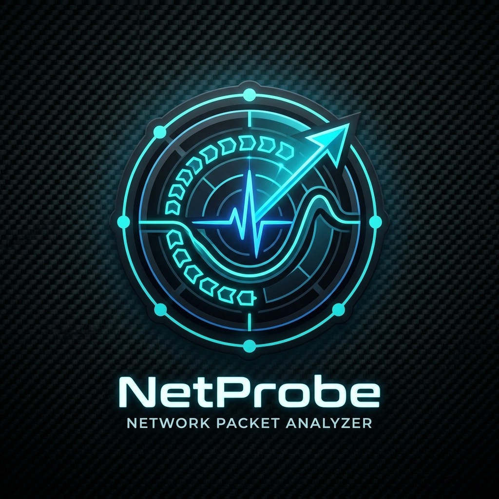
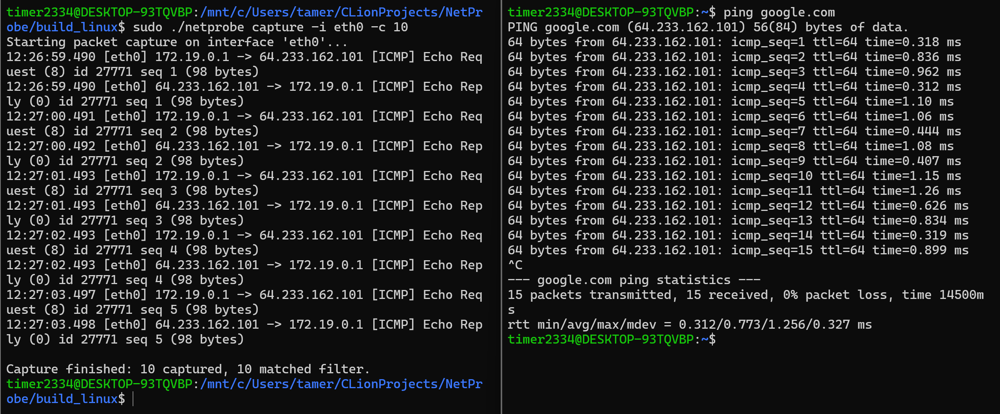
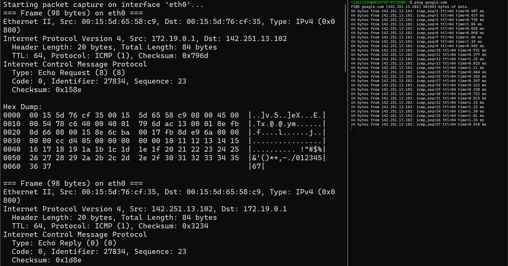
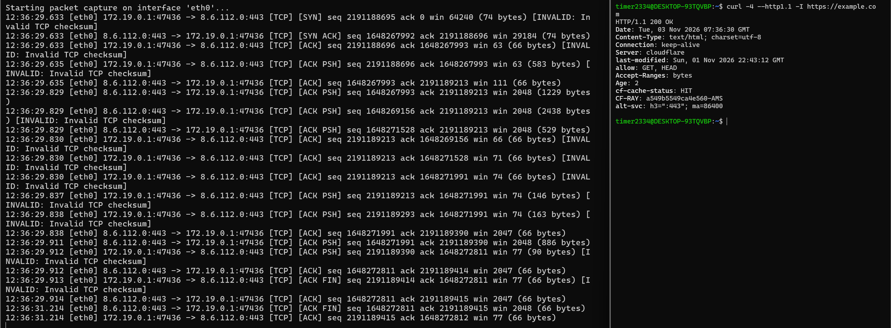

<div align="center">



# NetProbe

**Высокопроизводительный системный анализатор и диагност сетевых пакетов на Linux**

[](https://en.cppreference.com/w/cpp/20)
[](https://kernel.org)
[](https://man7.org/linux/man-pages/man7/packet.7.html)
[](https://cmake.org)
[](https://github.com/google/googletest)
[](LICENSE)

*Разработка системного уровня: захват сырого трафика через `AF_PACKET` / `SOCK_RAW`, Zero-Copy парсинг заголовков L2–L4 на C++20 `std::span`, верификация контрольных сумм RFC 791/793, аналитика трафика и ICMP Echo диагностика.*

</div>

---

## 📸 Галерея работы утилиты

### 1. Захват пакетов в реальном времени и декодирование протоколов (`capture`)
Перехват сырых Ethernet-кадров, фильтрация по протоколам и портам, вывод временных меток, IP-адресов, TCP-флагов, номеров последовательностей и полезной нагрузки:

<p align="center">
  
</p>

### 2. Подробный разбор сетевых уровней (L2–L4) и HEX/ASCII-дамп (`capture -v -x`)
Глубокая инспекция заголовков Ethernet II, полей IPv4 (IHL, TTL, Checksum, Flags), транспортных протоколов TCP/UDP/ICMP и полный шестнадцатеричный дамп содержимого:

<p align="center">
  
</p>

### 3. Статистический анализатор и ICMP-диагностика сети (`stats` & `ping`)
Агрегация сетевых метрик в реальном времени (pps, Mbits/s, распределение протоколов, матрица активных хостов) и собственная реализация утилиты `ping` на RAW-сокетах с расчетом RTT (min/avg/max/mdev):

<p align="center">
  
</p>

---

## ⚡ Ключевые возможности

- 🚀 **Прямой захват через AF_PACKET**: Захват канального уровня (L2) в неразборчивом режиме (`promiscuous mode`) без сторонних библиотек вроде `libpcap`.
- 🧩 **Zero-Copy парсинг**: Разбор структуры заголовков через `std::span<const uint8_t>` без лишних аллокаций памяти.
- 🛡️ **Packet Validator**: Полная проверка целостности пакетов и аппаратных аномалий по RFC 791 (IPv4), RFC 793 (TCP), RFC 768 (UDP) и RFC 792 (ICMP) с расчетом псевдозаголовков.
- 🔍 **Гибкий движок фильтрации**: Парсер строковых выражений фильтрации (`tcp port 80`, `src 192.168.1.0/24`, `syn`, `valid`).
- 📊 **Traffic Analyzer**: Отслеживание сетевых сессий (Flow Tracking), учет объема трафика по хостам и протоколам.
- 🎯 **Автономная диагностика ICMP Echo**: Отправка сырых ICMP-запросов и замер сетевой задержки с точностью до микросекунд.
- 🧪 **100% тестируемость без root**: Абстракция `IPacketSource` позволяет тестировать все модули и пайплайны захвата в CI/CD без привилегий суперпользователя.

---

## 🏗️ Архитектура проекта

Проект спроектирован по принципам **Clean Architecture** и **Domain-Driven Design (DDD)**:

```
NetProbe/
├── .github/
│   └── workflows/ci.yml        # Непрерывная интеграция GitHub Actions (сборка и автотесты)
├── docs/
│   └── images/                 # Логотип и скриншоты работы утилиты
├── include/netprobe/
│   ├── core/                   # Базовые типы данных, байт-ордер (endianness), иерархия исключений
│   ├── model/                  # Доменные сущности (MacAddress, IPv4Address, Ethernet, IP, TCP, UDP, ICMP)
│   ├── parser/                 # Парсеры заголовков L2-L4, валидатор контрольных сумм, декодер пакетов
│   ├── capture/                # Абстракция источников (IPacketSource), Linux RAW-сокеты, CaptureEngine
│   ├── filter/                 # Компилятор и матчер выражений фильтрации трафика
│   ├── analyzer/               # Статистический агрегатор (pps, bandwidth, top hosts, flow matrix)
│   ├── diagnostics/            # ICMP Echo клиент (ping, RTT, packet loss, jitter)
│   └── cli/                    # CLI-парсер аргументов и форматирование терминального вывода
├── src/                        # Исходный код реализации всех модулей
├── tests/                      # Набор тестов GoogleTest (10 тестов всех подсистем)
├── CMakeLists.txt              # Сценарий сборки CMake (netprobe_core, netprobe, netprobe_tests)
├── LICENSE                     # Лицензия MIT
└── README.md                   # Документация проекта
```

---

## 🛠️ Стек технологий

| Категория | Технологии | Назначение |
| :--- | :--- | :--- |
| **Язык программирования** | C++20 | Концепты, `std::span`, `std::endian`, `std::bit`, современные структуры |
| **Операционная система** | Linux (Kernel 5+) / WSL2 | Системные вызовы POSIX, сетевой стек Linux |
| **Сетевые интерфейсы** | `AF_PACKET`, `SOCK_RAW`, `ETH_P_ALL` | Низкоуровневый захват кадров канального уровня (L2) |
| **Поддерживаемые протоколы** | Ethernet II, 802.1Q VLAN, IPv4, TCP, UDP, ICMP | Декодирование, инспекция полей, валидация |
| **Система сборки** | CMake 3.22+, Ninja / Make | Кроссплатформенная декларативная сборка |
| **Тестирование** | GoogleTest 1.14, Linux NetNS (`veth`) | Модульное и интеграционное тестирование в изолированных namespaces |
| **CI / CD** | GitHub Actions | Автоматическая компиляция и запуск тестов при каждом push / pull request |

---

## 🔄 Пайплайн обработки сетевого кадра

```
 [ Сетевой адаптер / veth ]
             │
             ▼  (socket AF_PACKET, SOCK_RAW)
 [ LinuxRawSocketSource / MockPacketSource ]
             │
             ▼  (core::RawPacket)
 [ CaptureEngine (Worker Thread Pool) ]
             │
             ▼  (core::ByteSpan / Zero-Copy)
 ┌────────────────────────────────────────────────────────┐
 │                   Парсинг и декодирование              │
 │  1. EthernetParser   ───► MAC, VLAN ID, EtherType     │
 │  2. IPv4Parser       ───► IP Header, TTL, Protocol     │
 │  3. TransportParser  ───► TCP (Flags/Ports) / UDP / ICMP│
 └────────────────────────────────────────────────────────┘
             │
             ▼
 ┌────────────────────────────────────────────────────────┐
 │                   Валидация пакета                     │
 │  • Checksum Verification (IPv4, TCP, UDP, ICMP)        │
 │  • Length & Truncation Bounds Check                    │
 └────────────────────────────────────────────────────────┘
             │
             ├──► [ PacketFilter ]       ──► Фильтрация по критериям пользователя
             ├──► [ TrafficAnalyzer ]    ──► Учет потоков (FlowKey), битрейт, pps
             └──► [ CLI / Formatter ]    ──► Вывод в консоль / HEX-дамп
```

---

## 📦 Сборка и установка

### Системные требования:
- Linux (Ubuntu 22.04 / 24.04, Debian 12, Arch, Fedora) или WSL2
- Компилятор с поддержкой C++20 (`GCC 13+` или `Clang 16+`)
- `CMake 3.22+` и `Ninja` (или `make`)

### Команды сборки:
```bash
# 1. Клонирование репозитория
git clone https://github.com/your-username/NetProbe.git
cd NetProbe

# 2. Создание каталога сборки и конфигурация
cmake -B build -S . -G "Ninja" -DCMAKE_BUILD_TYPE=Release -DBUILD_TESTS=ON

# 3. Компиляция проекта
cmake --build build -j$(nproc)
```

В каталоге `build/` будут созданы:
- `netprobe` — основная исполняемая системная утилита.
- `netprobe_tests` — тестовый исполняемый модуль GoogleTest.

---

## 💻 Руководство по использованию

> **Важно:** Для доступа к реальным сетевым интерфейсам через `AF_PACKET` и отправки RAW ICMP требуются права суперпользователя (`sudo`) либо capability `cap_net_raw`.

### 1. Захват пакетов в реальном времени (`capture`)

```bash
# Захват всего входящего и исходящего трафика на интерфейсе eth0:
sudo ./netprobe capture -i eth0

# Захват только первых 100 пакетов:
sudo ./netprobe capture -i eth0 -c 100

# Фильтрация только TCP-трафика на порт 80 (HTTP) с HEX-дампом:
sudo ./netprobe capture -i eth0 -f "tcp port 80" -x

# Подробная инспекция структуры заголовков пакетов от заданного IP-адреса:
sudo ./netprobe capture -i eth0 -f "src 192.168.1.10" -v

# Фильтрация попыток установки новых соединений (TCP SYN):
sudo ./netprobe capture -i eth0 -f "syn"
```

### 2. Мониторинг статистики трафика (`stats`)

Непрерывный анализ пропускной способности канала (Mbits/s), интенсивности потока (pkts/s), протокольного распределения и самых активных хостов сети:

```bash
sudo ./netprobe stats -i eth0
```

*Пример вывода:*
```text
================ Traffic Statistics ================
Duration: 10.02 s
Total Packets: 1542 (153.9 pkts/s)
Total Bytes:   1245890 (0.995 Mbits/s)
---------------- Protocol Breakdown ----------------
IPv4:  1540 pkts, 1245600 bytes
  TCP:  1420 pkts, 1180200 bytes
  UDP:  110 pkts,  62400 bytes
  ICMP: 10 pkts,   3000 bytes
ARP:   2 pkts, 120 bytes
Invalid/Corrupted: 0 pkts
---------------- Top Active Hosts ------------------
192.168.1.105    Sent:    850 pkts (  620100 B),  Recv:    690 pkts (  625500 B)
142.250.180.206  Sent:    690 pkts (  625500 B),  Recv:    850 pkts (  620100 B)
====================================================
```

### 3. Диагностика сети через ICMP Echo (`ping`)

Собственная реализация утилиты ping без использования системных бинарников:

```bash
# Диагностика доступности узла (4 пакета по 56 байт):
sudo ./netprobe ping 8.8.8.8

# Отправка 10 пакетов с заданным размером полезной нагрузки и интервалом:
sudo ./netprobe ping 1.1.1.1 -c 10 -s 64 --interval 500
```

---

## 🧪 Тестирование

### 1. Запуск автоматических тестов (GoogleTest)

Все тесты работают изолированно и **не требуют root-прав**:

```bash
./build/netprobe_tests
```

```text
[==========] Running 10 tests from 6 test suites.
[----------] 2 tests from ModelTest (MacAddress, IPv4Address CIDR)
[----------] 4 tests from ParserTest (Ethernet, VLAN, IPv4, TCP, UDP, ICMP)
[----------] 1 test from FilterTest (Expression Parser & Matching)
[----------] 1 test from AnalyzerTest (Traffic Stats & Flow Tracking)
[----------] 1 test from CaptureTest (Multithreaded Capture Engine)
[----------] 1 test from DiagnosticsTest (Ping & RTT Estimation)
[==========] 10 tests from 6 test suites ran. (121 ms total)
[  PASSED  ] 10 tests.
```

### 2. Тестирование в изолированных Linux Network Namespaces

Для безопасного тестирования в виртуальном сетевом окружении Linux без подключения к реальным устройствам:

```bash
# 1. Создание изолированного пространства имен и виртуальной пары veth:
sudo ip netns add probe_ns
sudo ip link add veth0 type veth peer name veth1
sudo ip link set veth1 netns probe_ns

# 2. Назначение IP-адресов и активация интерфейсов:
sudo ip addr add 10.200.1.1/24 dev veth0
sudo ip link set veth0 up
sudo ip netns exec probe_ns ip addr add 10.200.1.2/24 dev veth1
sudo ip netns exec probe_ns ip link set veth1 up

# 3. В первом терминале запуск NetProbe на интерфейсе veth0:
sudo ./build/netprobe capture -i veth0 -v

# 4. Во втором терминале генерация трафика из пространства probe_ns:
sudo ip netns exec probe_ns ping -c 3 10.200.1.1
```

---

## 📄 Лицензия

Проект распространяется под открытой лицензией **MIT License**. Подробнее см. в файле [LICENSE](LICENSE).
